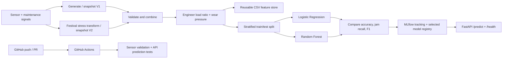

# Conveyor Jam Prediction Architecture

The target, `next_shift_jam`, is a binary label. The prediction is intended for
the next operating shift, not the current shift. Version 2 retains the same
shift-level equipment record while applying a 1.30 throughput multiplier plus
increased wear-related stress. The train/test split is stratified and metrics
are calculated on the positive jam class.
